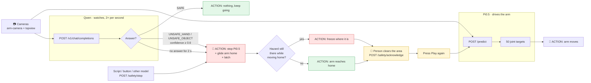

# Remote inference and a VLM safety monitor for runtime sessions

Status: draft, 2026-11-12. Branch `feature/remote-inference-safety` (from `main` @ 8f132416).

## 1. Goal

Run a robot task with two models on two accelerator cards of one remote machine:

- **Pi0.5** drives the follower (the policy, card 1).
- **Qwen** (vision-language model, card 0) watches the cameras while the policy runs. If it sees a
  hazard it **stops the policy and returns the arm to its home position**, and the policy cannot
  restart until a person acknowledges.

**Hazard** (decided 2026-11-12): any hand or person, or **any object that is not part of the task
scene**. The known scene is the arm itself, the coloured blocks, the bins and the table; anything else
in either camera view is unsafe.

The robot and cameras stay attached to the Studio machine. Both models run on the remote machine
(an Arc Pro B70 DevCloud host with two 32 GB cards) and are reached over an SSH tunnel.

Anything else — another model, a button, a script — must be able to trigger the same stop through
the API, so the stop path is independent of Qwen.

### Non-goals

- This is **not a certified safety function**. A VLM can miss hazards and reacts in hundreds of
  milliseconds, not microseconds. The physical power cut-off remains the emergency stop.
- No change to how policies are trained or exported.

## 2. Hardware layout

| Card | Model | Serving | Memory | Measured / expected |
|---|---|---|---|---|
| B70 GPU 1 (PCI 54:00.0) | Pi0.5 "210base 65ft", OpenVINO export | `remote_policy_server.py` | ~6.4 GB | 66–72 ms inference, **102 ms** end to end from Studio (live run, 2026-11-06) |
| B70 GPU 0 (PCI 18:00.0) | `Intel/Qwen3.6-27B-int4-AutoRound` (vision kept bf16) | vLLM 0.32 XPU, OpenAI API | 17.7 GiB weights, 79% cap, 1.7 GiB KV | **494 ms** per check (p90 504 ms), one-word verdict (2026-11-12) |

Measured 2026-11-12 on 30 normal frames of the sorting dataset (no hazards present):

| Prompt / reply format | Mean | p90 | Normal frames flagged | Flagged at ≥ 0.6 |
|---|---|---|---|---|
| Generic allow-list, JSON + reason | 2363 ms | 2469 ms | 21/30 | 21 |
| Scene-specific allow-list, JSON + reason | 2206 ms | 2342 ms | 2/30 | 2 |
| Scene-specific, JSON without reason | 1568 ms | 1599 ms | 1/30 | 1 |
| **Scene-specific, one word** | **494 ms** | **504 ms** | **1/30** | **0** |

Pi0.5 on GPU 1 stayed at 64 ms per chunk (966 calls) while Qwen ran on GPU 0: no interference.
Decode is ~35 ms/token, so output length dominates; prefill of two 448 px images + prompt (538 tokens)
is ~0.35 s. vLLM must be started with `--max-model-len 4096 --mm-processor-kwargs '{"max_pixels": 200704}'`
or its profiling leaves no KV cache on a card with the 6 GB baseline.

Fallback monitor models if Qwen3.6-27B INT4 is too slow: `Qwen/Qwen3.5-9B`, `Qwen/Qwen3.5-4B`.
Each card carries ~6.2 GB of baseline driver usage, so ~25.7 GiB is usable per card; FP8 27B (28.7 GiB)
does not fit.

## 3. Architecture

```
 Studio machine (robot + cameras)                                 B70 (remote)
 ┌──────────────────────────────────────────────────────┐         ┌──────────────────────────────┐
 │ RuntimeSession (API process)                          │         │                              │
 │  ├─ Store (shared memory): state, action, camera frames│         │                              │
 │  ├─ RobotWorker ── follows `action`                   │         │                              │
 │  ├─ CameraWorkers ── write frames                     │         │                              │
 │  ├─ ModelControl (thread) ── PolicySource ──┐         │         │                              │
 │  │                                          ▼         │  tunnel │ GPU 1: remote_policy_server  │
 │  ├─ ModelWorker (process) ── RemotePredictor ─────────┼────────►│  OpenVINO Pi0.5              │
 │  │                                                    │  :18765 │                              │
 │  ├─ SafetyWorker (process, NEW) ── reads frames ──────┼────────►│ GPU 0: vLLM Qwen-VL          │
 │  │     verdicts on the bus                            │  :18766 │                              │
 │  └─ SafetyLatch (NEW) ── set_control(None) + latch    │         └──────────────────────────────┘
 │                                                       │
 │ REST + WS: /api/runtime/sessions/{id}/safety/...      │◄── GUI, external monitors, scripts
 └──────────────────────────────────────────────────────┘
```

Pi0.5 and Qwen run concurrently and independently: the policy never waits for a safety check, and a
slow or failed check never delays an action. The only coupling is the stop.

### 3.1 How it works, in plain words

Two AI models run side by side on the B70. Studio talks to both over an SSH tunnel.

| | **Pi0.5** (the driver) | **Qwen** (the safety watcher) |
|---|---|---|
| Model | Pi0.5 "210base 65ft", OpenVINO export | `Qwen3.6-27B-int4-AutoRound`, served as `qwen-safety` by vLLM |
| Runs on | B70 GPU 1, port `18765` | B70 GPU 0, port `18766` |
| Gets | joint state + 2 camera images + task text | 2 camera images (448 px) + scene prompt |
| Returns | 50 joint targets (an action chunk) | one word: `SAFE`, `UNSAFE_HAND` or `UNSAFE_OBJECT` |
| How often | when the action queue runs out (~1 per second) | twice a second (2 Hz) |
| Inference time (on GPU) | **66–72 ms** | ~0.35 s prefill + 2–4 tokens |
| Latency seen by Studio | **~100 ms** (mean 100, p50 92 ms, 49 live calls) | **~0.43 s** (429–503 ms) |

Measured on 2026-11-12; see `docs/reports/2026-11-12-safety-api-tests.md`.

### 3.2 Flow: what the AI decides, and what happens next



Three rules:

1. **Pi0.5 never waits for Qwen.** A slow safety check delays the next check, never the arm.
2. **If the hazard is still there while the arm goes home, the arm freezes.** It does not finish
   homing on its own; send it with `POST /safety/home/go` once the area is clear.
3. **Only a person clears a stop, and clearing it does not restart anything.** Play is refused
   (`safety_latched`) until `acknowledge` is called.

### 3.3 The API calls, one by one

Base URLs: Studio `http://localhost:7860/api/runtime/sessions/<session_id>`, Pi0.5
`http://172.18.0.1:18765`, Qwen `http://172.18.0.1:18766/v1`. `application/backend/scripts/safety.sh` wraps the
Studio calls (`./safety.sh status | stop | hold | ack | capture-home | go-home | monitor-on | events`).

**Studio safety API** (what an operator or script calls):

| Step | Call | What happens |
|---|---|---|
| 1. Set home | `POST /safety/home/capture` | Current arm position is saved as home |
| 2. Turn on Qwen | `PUT /safety` with `{"monitor": {"enabled": true, ...}}` | Qwen starts checking at 2 Hz |
| 3. Check | `GET /safety` | Latch state, home pose, monitor health, last verdict |
| 4. Stop by hand | `POST /safety/stop` with `{"reason": "...", "source": "...", "hold": false}` | Same stop as Qwen's: policy stops, arm goes home, latch |
| 5. Send home | `POST /safety/home/go` | Arm glides home (refused while the policy runs) |
| 6. Clear | `POST /safety/acknowledge?source=operator` | Latch cleared; press Play to restart |
| 7. Review | `GET /safety/events` and `GET /safety/events/<id>/frames/<camera>` | What stopped, when, and the image it saw |

```bash
S=http://localhost:7860/api/runtime/sessions/<session_id>
curl -X POST $S/safety/home/capture
curl -X POST $S/safety/stop -H 'Content-Type: application/json' \
     -d '{"reason": "test", "source": "safety.sh", "hazard": "other", "hold": false}'
curl -X POST "$S/safety/acknowledge?source=operator"
curl $S/safety
```

**Model APIs** (what Studio calls for you; shown so you can test each model alone):

```bash
# Pi0.5: which model is loaded (Studio checks the fingerprint before driving the arm)
curl http://172.18.0.1:18765/info
# -> {"backend": "openvino", "device": "GPU", "fingerprint": "63347f77…"}       7 ms

# Pi0.5: one prediction. Images are base64 JPEG, keys "images.<camera>"
curl -X POST http://172.18.0.1:18765/predict -H 'Content-Type: application/json' -d @pi_body.json
#   pi_body.json = {"state": [[6 joints]], "images": {"images.topview": "<b64>", "images.arm-camera": "<b64>"},
#                   "task": "Sort this item into the correct bin"}
# -> {"action": [[50 x 6]], "infer_ms": 66.5}                                    85 ms total

# Qwen: one safety check, one-word answer with its probability
curl -X POST http://172.18.0.1:18766/v1/chat/completions -H 'Content-Type: application/json' -d @qw_body.json
#   qw_body.json = {"model": "qwen-safety", "temperature": 0, "max_tokens": 6, "logprobs": true,
#                   "structured_outputs": {"choice": ["SAFE", "UNSAFE_HAND", "UNSAFE_OBJECT"]},
#                   "chat_template_kwargs": {"enable_thinking": false},
#                   "messages": [{"role": "user", "content": [<2 images>, <scene prompt>]}]}
# -> "content": "UNSAFE_HAND", first-token probability 0.977                       0.8–1.1 s*
```

\* Called by hand while the monitor was also checking twice a second, so the call queued behind it.
The monitor's own checks take 0.43 s.

## 4. Components

### 4.1 Remote policy inference (`RemotePredictor`)

`workers/model_worker.py` already defines a `Predictor` protocol (`predict_action_chunk`, `reset`)
and an `open_model()` hook. A remote device plugs in there:

- `ModelWorker.open_model()` returns `RemotePredictor(export_dir, url)` when `device == "REMOTE"`,
  otherwise the existing `InferenceModel`.
- `RemotePredictor.predict_action_chunk(observation)` takes the worker's flat observation
  (`state`, `images.<camera>` as `H×W×3 uint8`, optional `task`), JPEG-encodes each frame (q95,
  ~45 KB/frame), POSTs to `/predict`, returns the `(chunk, action_dim)` array.
- On load it calls `/info` and compares a **weights fingerprint** (size + SHA-256 of the first and
  last 16 MiB of the weights file) with the local export. A mismatch fails the load: the robot is
  never driven by a different model than the one selected.
- HTTP client ignores proxy environment variables (`trust_env=False`) so tunnel traffic is not sent
  to a corporate proxy.
- Per-call timing (encode, request, remote inference, network, total, payload) is appended to a CSV
  when configured — the instrument used for the 2026-11-06 live numbers.

The device appears in `GET /api/system/devices/inference` as `{backend: "openvino", device: "REMOTE",
name: "<configured name>"}` only when a remote inference config is present.

### 4.2 Safety monitor (`SafetyMonitor`)

*As built (phase 3):* an asyncio task the session starts when it opens
(`runtime_session/safety_monitor.py`), not a separate process: a check is network I/O plus two
small JPEG encodes, and the encodes run on a thread. It reads the newest frames from the session's
store and is idle while `monitor.enabled` is false, no endpoint is set, or no environment is loaded.
Settings live in `SafetyConfig.monitor` (`MonitorConfig`), kept per follower with the home pose; a
`PUT /safety` that leaves a field out keeps its current value.

Loop, at `check_hz` (default 2 Hz; each check is skipped if the previous one is still in flight):

1. Read the newest frame of each configured camera. A frame older than `max_frame_age_s` is a fault
   (frozen camera), not a "safe" verdict.
2. Downscale to `image_max_side` (default 448 px) and JPEG-encode — fewer image tokens, faster prefill.
3. POST `/v1/chat/completions` to the monitor endpoint with the prompt, the images, `temperature: 0`,
   thinking disabled (`chat_template_kwargs: {enable_thinking: false}`), and a **one-word constrained
   reply** — `structured_outputs: {choice: ["SAFE", "UNSAFE_HAND", "UNSAFE_OBJECT"]}` with
   `logprobs`. Confidence is the probability of the reply's first token, so `P(unsafe) = 1 − P(SAFE)`.
   This is ~4 output tokens instead of ~55 for JSON with a reason: 0.5 s per check instead of 2.3 s.
   The verdict is mapped to the event shape:

   ```json
   {"safe": false, "hazard": "hand_or_person", "confidence": 0.93, "answer": "UNSAFE_HAND"}
   ```
   `hazard` ∈ `none | hand_or_person | unknown_object`. A free-text `reason` is not generated on the
   hot path; when a stop fires, the monitor may ask once more with a JSON + reason prompt purely for the
   event log (it does not delay the stop).

   The prompt lists the known scene explicitly and asks for `unsafe` on any hand, person, or
   anything else — an allow-list, not a list of hazards, so unforeseen objects are caught. It must
   describe the **actual** cell, or normal things are flagged: with a generic list, 21/30 normal frames
   were flagged (bin logos read as people, the tripod and wall behind the desk, the arm's own circuit
   boards and wires). What fixed it: judge only the white mat and ignore everything beyond it; list the
   arm's exposed electronics, the green TRASH bin and blue RECYCLE bin; and say that the wrist camera
   sees bins, logos and blocks very close and cut off at the edges. The prompt is per session
   (`prompt`) because it is specific to the cell.
4. Publish the verdict on the session bus (`evt/safety/verdict`).
5. Decide (see 4.3) and, when it is a stop, request it from the session.

Monitoring runs whenever enabled, but the monitor only **acts while it guards**: a control in
`stop_controls` (default: model) drives, or the follower is moving home. Otherwise verdicts are only
reported — a hand setting up the bench does not latch an idle session, and an outage while idle
does not count towards the fail-safe. One fail-safe stop is made per outage. Frames a stop was
judged on are saved under `<storage>/safety/frames/<event_id>/` and served at
`GET /safety/events/{event_id}/frames/{camera}`. Verdicts go to the socket as `safety` messages
(SAFE ones at most twice a second); `SessionState.safety.monitor` carries `health`
(`off | ok | degraded | down`), `guarding`, `last_verdict` and `error`.

### 4.3 Stop decision and the safety latch

Stop when any of:

- `unsafe_consecutive` (default 1) verdicts in a row have `safe: false` and
  `confidence ≥ min_confidence` (default 0.6);
- the monitor is **unhealthy** for longer than `fail_safe_after_s` (default 2 s): endpoint unreachable,
  timeouts, unparseable replies, or stale frames. Fail closed: an unwatched robot stops.

The stop has two steps, both using what the session and robot worker already do:

1. **Stop the policy** — `set_control(None)` joins the model control and writes the follower's current
   state to `action`, so the arm stops where it is (torque on). This happens within one control tick.
2. **Return home** — write the configured `home_pose` to `action` stamped `home_duration_s` (default 4 s)
   in the future. The robot worker already approaches a future-stamped action linearly, so the arm
   glides home at a bounded speed; no new robot code is needed.

`on_stop` selects the behaviour: `home` (default, decided 2026-11-12) or `hold` (skip step 2).
The session does **not** `stop()` (that releases devices).

**Moving while a hazard is present.** Returning home means the arm moves while a hand or object may
still be in the workspace. Mitigations:

- The home pose is recorded by the operator (§5.1 `home/capture`) as a tucked pose clear of the
  work area, and the move is slow (`home_duration_s`, and `max_joint_speed` caps it further).
- The monitor keeps checking during the move. Another unsafe verdict, or `POST safety/stop` with
  `"hold": true`, **freezes the arm where it is** (step 1 only) and stays frozen until acknowledged.
- With no home pose recorded, `on_stop: home` falls back to `hold` and reports it in `health`.

The **latch** then makes the stop stick:

```
           enable                     unsafe / fail-safe / POST safety/stop
 DISABLED ───────► MONITORING ───────────────────────────────────────────► LATCHED
     ▲                 │  ▲                                                   │
     └──── disable ────┘  └────────── POST safety/acknowledge (human) ────────┘
```

- While `LATCHED`, `set_control` with a model config is rejected with a `safety_latched` error;
  `set_control(None)` and teleop stay allowed so an operator can move the arm clear.
- Acknowledging clears the latch but **does not resume** — the user presses Play again.
- The latch lives on the `RuntimeSession`, so it covers every client (GUI, scripts) and every stop
  source (monitor, REST, future sources).
- Stop latency budget (to the arm stopping, before it starts home): check interval + check duration
  + one control tick. At 2 Hz and ~1 s checks, ~1.5 s worst case; at ~0.3 s checks (smaller model), ~0.8 s.
  The return home then takes `home_duration_s`.

## 5. API

**Implemented in phase 2** (6ff0bc88): the latch, stop/acknowledge, home capture/go, config and events
below, with latch states `clear | latched | homing` (`SessionState.safety`). The monitor fields of
`SafetyConfig` and `SafetyStatus` (`enabled`, `endpoint`, `cameras`, `check_hz`, `health`,
`last_verdict`, …) and the per-stop frames come with phase 3. `acknowledge` takes `?source=`.
Bus commands on the session socket: `safety_stop`, `safety_acknowledge`, `set_safety`,
`capture_home`, `go_home`; events arrive as `{"type": "safety", "data": SafetyEvent}`.

All new routes sit under the existing runtime-session router (`/api/runtime/sessions`), which is
process-wide, not project-scoped — the same scope as the existing `POST /{session_id}/stop`.

### 5.1 REST

| Method | Path | Purpose |
|---|---|---|
| `GET` | `/api/runtime/sessions/{session_id}/safety` | Safety status: state, config, monitor health, last verdict, counters |
| `PUT` | `/api/runtime/sessions/{session_id}/safety` | Enable/disable monitoring and set its config |
| `POST` | `/api/runtime/sessions/{session_id}/safety/stop` | Stop the running model control and latch. For any external source |
| `POST` | `/api/runtime/sessions/{session_id}/safety/acknowledge` | A person clears the latch; nothing resumes |
| `POST` | `/api/runtime/sessions/{session_id}/safety/home/capture` | Record the follower's current position as the home pose |
| `POST` | `/api/runtime/sessions/{session_id}/safety/home/go` | Move to the home pose now (manual; refused while a control runs) |
| `GET` | `/api/runtime/sessions/{session_id}/safety/events` | Recent verdicts and stops, newest first (`?limit=`, `?stops_only=`) |
| `GET` | `/api/runtime/sessions/{session_id}/safety/events/{event_id}/frames/{camera}` | JPEG that triggered a stop |
| `GET` | `/api/runtime/sessions/{session_id}/cameras/{camera}/latest.jpg` | Newest frame, for external monitors that bring their own model |
| `GET` | `/api/system/devices/inference` | (existing) also lists the remote policy device when configured |

`POST .../safety/stop` body:

```json
{ "reason": "light curtain tripped", "source": "plc-gateway", "hazard": "unknown_object", "hold": false }
```
`hold: true` freezes the arm instead of returning home (also used to interrupt a move home).
Response `200` with the `SafetyStatus` below. Idempotent: stopping while latched returns the current
status and records the extra event. `404` unknown session; `409` no environment loaded.

`PUT .../safety` body (`SafetyConfig`):

```json
{
  "enabled": true,
  "endpoint": "http://172.18.0.1:18766/v1",
  "model": "qwen-safety",
  "cameras": ["topview", "arm-camera"],
  "check_hz": 2.0,
  "image_max_side": 448,
  "timeout_s": 3.0,
  "min_confidence": 0.6,
  "unsafe_consecutive": 1,
  "fail_safe_after_s": 2.0,
  "max_frame_age_s": 1.0,
  "stop_controls": ["model"],
  "on_stop": "home",
  "home_pose": [0.0, -95.0, 95.0, 70.0, 0.0, 2.0],
  "home_duration_s": 4.0,
  "max_joint_speed": 45.0,
  "prompt": null
}
```
`home_pose` is in the follower's joint units and order (`null` until captured; the values above are
only an example). `max_joint_speed` (units/s) lengthens the move home if `home_duration_s` would be faster.
`prompt: null` uses the built-in prompt. `400` for unknown cameras; the endpoint is probed and an
unreachable endpoint is reported in `health`, not rejected (it may come up later).

`SafetyStatus`:

```json
{
  "session_id": "…",
  "state": "monitoring",            // disabled | monitoring | latched | homing
  "health": "ok",                   // ok | degraded | down
  "config": { … },
  "last_verdict": { "at": "2026-11-12T20:15:03.120Z", "safe": true, "hazard": "none",
                    "confidence": 0.97, "reason": "…", "latency_ms": 980 },
  "latched_by": null,               // event id of the stop that latched
  "counters": { "checks": 1840, "unsafe": 3, "stops": 1, "errors": 0 }
}
```

`SafetyEvent`:

```json
{ "id": "…", "at": "…", "kind": "verdict | stop | acknowledge | health",
  "source": "monitor | api:<source> | gui", "safe": false, "hazard": "hand_or_person",
  "confidence": 0.93, "reason": "…", "latency_ms": 1012, "frames": ["topview", "arm-camera"] }
```
Events are kept in a ring buffer per session (default 500) and stops with their frames are also
written under `/app/storage/safety/<session_id>/` for later review and prompt tuning.

### 5.2 Session bus and websocket

On the session's bus, so the session websocket (`/api/runtime/ws`) carries them to the GUI:

- `evt/safety/verdict` → `{type: "safety_verdict", data: SafetyEvent}` — throttled to ≤2/s on the socket.
- `evt/safety/stop` → `{type: "safety_stop", data: SafetyEvent}` — always sent.
- `SessionState` gains `safety: {state, health}`, so the existing `state` message reflects a latch.
- Bus commands mirroring the REST calls for the GUI: `set_safety`, `safety_stop`, `safety_acknowledge`.

## 6. Configuration

- Remote policy device: `/app/storage/remote_inference.json`
  `{url, name, memory, timing_log}` — file-based so it survives container restarts.
- Monitor defaults: the same file's `safety` section, overridable per session via `PUT .../safety`.
- B70 side: `~/yogini/remote-inference/start.sh` (Pi0.5, GPU 1), `~/yogini/qwen-safety/start_qwen.sh`
  (Qwen, GPU 0). Both bind to `127.0.0.1` on the B70; the Studio host reaches them with
  `ssh -L 172.18.0.1:18765:127.0.0.1:18765 -L 172.18.0.1:18766:127.0.0.1:18766 b70`
  (`172.18.0.1` is the Studio container's gateway).

## 7. Failure modes

| Failure | Behaviour |
|---|---|
| Qwen says unsafe | Policy stopped + latch within one control tick of the verdict, then arm returns home over `home_duration_s` |
| Unsafe again while homing | Arm freezes where it is; stays latched |
| No home pose recorded | Holds instead of homing; `health: degraded` until a pose is captured |
| Qwen endpoint down / timeouts / bad JSON for > `fail_safe_after_s` | `health: down`, hold + latch (fail closed) |
| Camera frozen (frame older than `max_frame_age_s`) | Treated as monitor unhealthy |
| Tunnel drops during policy inference | `RemotePredictor` raises, model control ends, session holds (existing behaviour) |
| Remote policy server has a different model | Model load fails with a fingerprint mismatch |
| False stop | Operator acknowledges; event + frames saved for tuning `min_confidence`, `unsafe_consecutive`, prompt |
| Session stopped / environment unloaded | `SafetyWorker` stops with it; latch is cleared with the session |

## 8. Code changes

| Area | Change |
|---|---|
| `models/remote_inference.py` (new) | `RemotePredictor`, fingerprint, config loader, timing log |
| `scripts/remote_policy_server.py` (new) | HTTP server for one export (`/info`, `/predict`) |
| `workers/model_worker.py` | `open_model()` returns `RemotePredictor` for `device == "REMOTE"` |
| `services/system_service.py` | lists the remote device when configured |
| `runtime_session/safety.py` (new) | `SafetyConfig`, `SafetyLatch`, decision logic |
| `workers/safety_worker.py` (new) | `SafetyWorker` process: store frames → VLM → verdicts on the bus |
| `runtime_session/session.py` | owns latch + worker; `set_control` checks the latch; `safety_*` bus commands |
| `schemas/runtime_session.py` | `SafetyConfig`, `SafetyStatus`, `SafetyEvent`, `SessionState.safety`, messages |
| `api/runtime_sessions.py` | the REST routes of 5.1 |
| UI | safety toggle + status dot in Run model; red banner with reason, frame, **Acknowledge** |

## 9. Test plan

1. **Unit**: decision logic (thresholds, consecutive, fail-safe timer), latch transitions, `set_control`
   rejection while latched, `RemotePredictor` fingerprint mismatch — with fake predictors / fake VLM
   endpoint, following the `open_model()` test hook pattern.
2. **API**: each route with a fake session; idempotent stop; acknowledge without latch.
3. **Bench (B70)**: `reports/b70-bench/bench_qwen_safety.py` — per-check latency, false stops on 30
   dataset frames, missed hazards on staged hazard photos, Pi0.5 latency with Qwen running concurrently.
4. **Live**: stop latency from hazard onset (hand enters the overhead view) to the follower holding,
   measured from the event log and camera timestamps; false-stop rate over full sorting episodes.

## 10. Phases

0. Serve Qwen3.6-27B INT4 on GPU 0, benchmark; choose the monitor model. *(done; hazard frames still to test)*
1. Port remote policy inference to `main`'s `ModelWorker.open_model()`. *(done, 4e093cc7)*
2. Safety latch + REST/bus stop/acknowledge/status — testable with `curl`, no VLM needed. *(done, 6ff0bc88)*
3. `SafetyMonitor` + config + events. *(done)*
4. UI.
5. Live validation on the SO-101.

## 11. Open questions

- Calibrate `min_confidence` on real hazard frames (hands, tools, a cup, a phone, a sleeve at the edge
  of the view). On normal frames `P(unsafe)` reached up to 0.6, so 0.6 is the floor; the hazard set
  decides how much higher it can go without missing hazards.
- Should a stop during teleop also latch (`stop_controls`)? Default: model only.
- Acknowledge permissions: any client, or GUI only?
- Keep remote-device config file-based, or move it into the database next to remote trainers?
