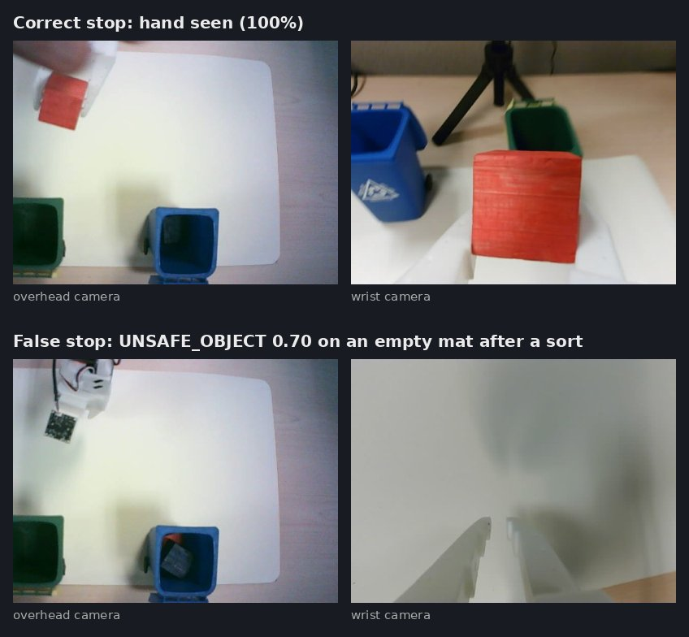
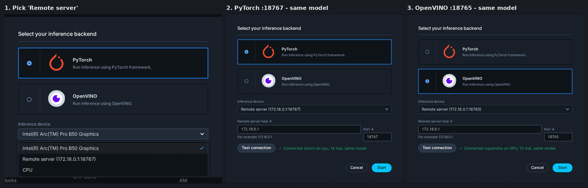

# Remote inference and safety monitor: test report

**Period:** 2026-11-12 to 2026-11-17 · **Robot:** SO-101, sorting cubes into two bins ·
**Branch:** [`yogit2020/physical-ai-studio` · `feature/remote-inference-safety`](https://github.com/yogit2020/physical-ai-studio/tree/feature/remote-inference-safety)

This report sums up everything tested: the two AI models, how fast they are, what the safety
monitor did on the real arm, the bugs found, and the new UI for picking a remote server. The design
is in [remote-inference-and-safety-monitor.md](../feature_plans/remote-inference-and-safety-monitor.md).

## 1. Summary

| | Result |
|---|---|
| **Pi0.5 on OpenVINO** (remote B70) | **72 ms** on the GPU, **95 ms** round trip, 152 live calls. The arm sorted cubes |
| **Pi0.5 on PyTorch** (remote B70, new) | **341 ms** on the GPU, **~360 ms** round trip, 35 live calls. The arm ran with safety off and on |
| **Same model on both?** | **Yes.** With the same start noise the actions differ by 0.05–0.14 on average, against 0.82 between two normal samples |
| **Qwen safety check** | **0.47 s** per check (new prompt), twice a second, on its own GPU. It never slows Pi0.5 down |
| **Hand stops** | **4 of 4 correct** (OpenVINO ×3, PyTorch ×1). Each one stopped the policy in < 2 ms; the arm went home, and froze when the hand was still there |
| **False stops** | 3, all `UNSAFE_OBJECT` around the bins. A new prompt cuts them from 5 to 1 in 101 test frames |
| **Bugs found and fixed** | 4: `safety.sh` crash, new sessions not monitoring, and 2 in the new UI |
| **New UI** | Pick a remote server per backend by host and port, with **Test connection** (section 5) |

## 2. Setup

| | |
|---|---|
| Studio machine | i9-11900T, Arc Pro B50 + B60. Studio container `physical-ai-studio-xpu`, port 7860, robot and both cameras attached |
| Remote machine | Intel DevCloud host with **2 × Arc Pro B70** (32 GB each), reached over an SSH tunnel on `172.18.0.1` |
| Policy model | **Pi0.5 "210base 65ft"**, Hugging Face `muniker/pi05-so101-sort-210base-65ft`, trained in Physical AI Studio |
| Safety model | **Qwen3.6-27B INT4** (`Intel/Qwen3.6-27B-int4-AutoRound`), vLLM, served as `qwen-safety` |
| Cameras | `arm-camera` (wrist) and `topview` (overhead) |
| Task | "Sort this item into the correct bin" |

| Server on the B70 | GPU | Port | Serves |
|---|---|---|---|
| `yogini-pi05-server` | 1 | 18765 | Pi0.5, `exports/openvino` (OpenVINO, GPU) |
| `yogini-pi05-torch` (new) | 1 | 18767 | Pi0.5, `exports/torch/pi05.pt` (PyTorch, XPU), no conversion |
| `yogini-qwen-safety` | 0 | 18766 | Qwen safety monitor |

```
 Studio machine                                   B70 (remote)
 ┌─────────────────────────────┐   SSH tunnel   ┌──────────────────────────────────┐
 │ cameras + SO-101 arm        │ ──── :18765 ──►│ GPU 1  Pi0.5 OpenVINO            │
 │ Studio: Play → policy loop  │ ──── :18767 ──►│ GPU 1  Pi0.5 PyTorch (new)       │
 │         safety monitor 2 Hz │ ──── :18766 ──►│ GPU 0  Qwen3.6-27B safety model  │
 └─────────────────────────────┘                └──────────────────────────────────┘
```

## 3. What we tested

| Area | What was checked | Result |
|---|---|---|
| **Studio safety API** | capture home, manual stop, Play refused while latched, acknowledge, events, stop frames, monitor on/off | ✅ all calls work on the real arm |
| **Models by direct `curl`** | Pi0.5 `/info` + `/predict`, Qwen `/v1/chat/completions` on hand and clean frames | ✅ Pi0.5 returns a 50×6 chunk; Qwen 6/6 correct |
| **Live runs, OpenVINO** | 11 runs on the arm, with the monitor on and off, including full sorts | ✅ cubes sorted; timings in section 4 |
| **Live runs, PyTorch** | 3 runs on the arm: safety off, then on | ✅ ran; a hand stopped it correctly |
| **Hand stops** | a hand in view while Pi0.5 drives | ✅ 4/4 stopped; the arm went home, and froze when the hand stayed |
| **False stops** | stops with no hazard | ⚠️ 3 live (0.70–0.75 confidence), 1 near miss (0.559) |
| **Scene prompt** | old vs new prompt on 101 dataset frame pairs + the 4 real hand stops | ✅ false stops 5 → 1, all hands still caught |
| **New-session bug** | a newly opened session monitored nothing | ✅ fixed, with a unit test |
| **openpi PR #1009** | `docs/xpu.md` steps 1–5 on the B70, with openpi's LIBERO demo | ✅ 126 ms client / 120 ms policy, as the guide expects |
| **PyTorch export** | Pi0.5 `pi05.pt` served on XPU, called by Studio's own client | ✅ works, ~4.7× slower than OpenVINO |
| **Same model check** | OpenVINO vs PyTorch with the same frames, state and noise | ✅ same model (section 4.3) |
| **Remote server API + UI** | host/port per backend, Test connection, wrong-model warning, in a real browser | ✅ section 5 |

**One correct stop and one false stop**, as Qwen saw them:



- **Top, 11-17 00:16:27, PyTorch running:** Qwen saw the hand (100%). The policy stopped in 1 ms and
  the arm went home, then froze 0.55 s later because the hand was still there.
- **Bottom, 11-13 00:07:59:** the cube is already in the blue bin and the mat is empty, but Qwen said
  `UNSAFE_OBJECT` at 0.70, probably because of the cubes inside the bin or the gripper's shadow.

## 4. Inference time and latency

*Inference* is the time on the B70 GPU. *Round trip* is what Studio sees: JPEG encode, network,
inference and reply.

### 4.1 Pi0.5, live on the arm

| Backend | Safety | Runs | Calls | Inference mean / p50 / p90 | Round trip mean / p50 / p90 / max | New chunk every |
|---|---|---|---|---|---|---|
| **OpenVINO** | on | 8 | 94 | 72.5 / 70.7 / 73.4 ms | 93.7 / 91.4 / 106.1 / 120.0 ms | 0.93 s |
| **OpenVINO** | off | 3 | 58 | 71.9 / 70.5 / 73.2 ms | 97.9 / 92.1 / 99.3 / 306.9 ms | 0.93 s |
| **OpenVINO** | all | 11 | 152 | **72.3** / 70.6 / 73.2 ms | **95.3** / 91.6 / 103.1 / 306.9 ms | 0.93 s |
| **PyTorch** | off (00:14:35) | 1 | 16 | 338.8 / 339.1 / 344.8 ms | 359.8 / 358.4 / 372.1 / 378.8 ms | 1.19 s |
| **PyTorch** | on (00:16:16) | 1 | 10 | 340.9 / 341.3 / 358.1 ms | 360.3 / 360.5 / 377.3 / 377.3 ms | 1.20 s |
| **PyTorch** | on (00:17:09) | 1 | 9 | 343.9 / 346.3 / 351.3 ms | 442.0 / 365.1 / 1068 / 1068 ms* | 1.20 s |
| **PyTorch** | all | 3 | 35 | **341** / 341 / 351 ms | **~380** / 360 / 378 / 1068 ms | 1.20 s |

\* One call took 1,068 ms, all of it network (96 ms mean network in that run, about 18 ms otherwise).

**Safety on or off makes no difference to Pi0.5's speed**, on either backend: Qwen runs on the
other GPU. PyTorch is **~4.7× slower** on the GPU, so each new chunk comes ~0.27 s later and the arm's
pause per chunk is longer.

### 4.2 Pi0.5, direct calls (no arm)

| Test | Backend | Inference | Round trip | First call |
|---|---|---|---|---|
| `curl` ×5 | OpenVINO | 65.5–66.7 ms | 84–90 ms | 117 ms |
| Studio client ×4 | OpenVINO | | 84–88 ms | 116 ms |
| Parity script ×10 | OpenVINO (noise as input) | 68–70 ms | | 320 ms |
| `curl` ×8 | PyTorch | 330 ms mean | 341–356 ms | 3.4 s |
| Studio client ×4 | PyTorch | | 344–357 ms | 3.2 s |
| Parity script ×10 | PyTorch | 331–354 ms | | 2.3 s |
| openpi smoke test ×5 | openpi PyTorch, **LIBERO demo model** (chunk 10, compiled) | 120 ms | 126 ms | ~6 min compile |

Server start-up: OpenVINO loads in 22 s, PyTorch in 99 s.

### 4.3 Is the PyTorch model the same model?

Same 3 dataset moments × 3 start noises into both. Differences in joint units over the whole 50×6 chunk:

| | Mean | Max |
|---|---|---|
| **OpenVINO vs PyTorch, same noise** | **0.05–0.14** | **0.21–0.51** |
| PyTorch vs itself, same noise | | 0.19 |
| OpenVINO vs itself, same noise | | 0.02 |
| One backend, two different noises | 0.81–0.82 | 4.7–4.9 |

The two backends differ 6–16× less than two samples of one backend: **same model**, differing only
in GPU precision.

### 4.4 Qwen safety check

| Test | Prompt | Checks | Mean | p50 | Range |
|---|---|---|---|---|---|
| Live monitor | old | 12 | 438 ms | 432 ms | 429–503 ms |
| Live monitor | **new** | 20 | **474 ms** | **474 ms** | 470–480 ms |
| Offline, 105 frame pairs | old | 105 | 440 ms | 433 ms | 426–507 ms |
| Offline, 105 frame pairs | new | 105 | 464 ms | 457 ms | 454–576 ms |
| Direct `curl` while the monitor also ran | old | 6 | 850 ms | | 720–1140 ms (queued behind monitor checks) |

Each check sends two 448 px images and the scene prompt (~551 tokens) and gets back one word,
`SAFE`, `UNSAFE_HAND` or `UNSAFE_OBJECT` (2–4 tokens). The new prompt is longer: +24 ms per check.

### 4.5 Stop timing

| Step | Time |
|---|---|
| Qwen check | 0.44–0.48 s |
| Unsafe verdict → Pi0.5 stopped | **< 2 ms** (4 of 4 hand stops) |
| Stop → second check sees the hand while homing → arm freezes | 0.51–0.55 s |
| Worst case, hand appears → stop | ≈ one check interval + one check ≈ 0.5 + 0.47 ≈ **1.0 s** |

## 5. New UI: remote server by host and port

Where a model is loaded (**Models → Run model**, or **Load model** in a session), each backend has a
**Remote server** device. Choosing it shows the server's host and port, and **Test connection**
saves them and asks the server what it runs.



1. **Pick "Remote server"** in the device list. It is listed beside the local GPU and CPU, and is
   never picked automatically.
2. **PyTorch:** host `172.18.0.1`, port `18767`. Test connection: connected, `torch on xpu`, same model.
3. **OpenVINO:** each backend keeps its own server, here port `18765`.

What Test connection can show:

| Message | Meaning |
|---|---|
| ✓ Connected (torch on xpu, 14 ms), same model | Reachable, and it runs the model being loaded |
| ⚠ Connected (…), but it runs another model than this one. Loading will be refused. | Reachable, wrong model: checked by weights fingerprint |
| ✗ Not reachable at http://…: … | Down, wrong port, or the SSH tunnel is not up |

Behind it ([design §3.4](../feature_plans/remote-inference-and-safety-monitor.md)):

| Call | Does |
|---|---|
| `GET /api/system/remote-inference` | The server set for each backend |
| `PUT /api/system/remote-inference/{openvino\|torch}` `{"host", "port"}` | Save one backend's server |
| `POST /api/system/remote-inference/check` `{"host", "port", "model_id", "backend"}` | Reachable? latency, backend, device, same model |

Tests: 9 new backend tests and 4 new UI tests. 186 UI tests and all backend tests around this code
pass. Checked live against both B70 servers, including the wrong-model case (PyTorch model against
the OpenVINO port → `same_model: false`).

## 6. Bugs found and fixed

| Bug | Effect | Fix |
|---|---|---|
| `safety.sh` status summary crashed (`\"` inside an f-string, inside bash single quotes) | No status after `capture-home`, though the call worked | Python moved into a quoted heredoc |
| **A new session did not run the monitor** until some safety call | A hand did not stop Pi0.5 in a freshly opened session | The session loads the arm's saved safety settings when the environment loads; unit test added |
| UI: the test result vanished right after "Save and test" | The saved-server refresh reset the fields | Fields reset only on a backend change; filled only while empty |
| UI: typing a port, then clicking the button at once, did nothing | The port field commits on blur, after the click had run | The button reads the latest typed values |

## 7. Known issues and next steps

| Issue | Next step |
|---|---|
| False `UNSAFE_OBJECT` stops near the bins and on an empty mat after a sort (0.70–0.75) | Allow "cubes inside a bin" and "the arm's shadow" in the prompt, or set `unsafe_consecutive: 2` (+0.5 s per real stop) |
| PyTorch is ~4.7× slower than OpenVINO | Compile the PyTorch model (openpi's `max-autotune` reached 120 ms on its demo); expected 120–180 ms (estimate) |
| The OpenVINO export uses one fixed start noise for every chunk | Convert it to take noise as an input (`python -m physicalai.policies.pi05.noise_input`), then compare on the arm |
| The SSH tunnels drop when the connection breaks | Restart them; port 18767 has its own tunnel |
| Not tested yet | objects other than hands, the 2 s fail-safe (Qwen down or a frozen camera), stop latency against camera timestamps, more full episodes for a false-stop rate |
